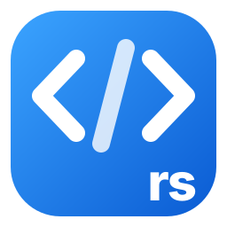

<p align="center"></p>

# code-rs

**VS Code without Electron.** code-rs runs the Visual Studio Code workbench inside a
[Tauri 2](https://tauri.app) shell written in Rust. The editor you know is unchanged;
what is underneath is not.

> **code-rs is a fork of [microsoft/vscode](https://github.com/microsoft/vscode)
> ("Code - OSS", MIT licensed).** It is not affiliated with, endorsed by or supported by
> Microsoft. "Visual Studio Code" and "VS Code" are trademarks of Microsoft; code-rs does
> not use the Microsoft product build, marketplace or branding.

## What changed compared to VS Code

| Area | VS Code | code-rs |
|---|---|---|
| Shell | Electron (Chromium + Node.js in every window) | **Tauri 2 (Rust)** + the system WebView (WebView2 / WebKit) |
| File system, file watching | Node.js in the main process | **Rust** (`std::fs`, `notify`) |
| Text and file search | ripgrep binary | **Rust** ripgrep crates (`grep`, `ignore`) in-process |
| Integrated terminal | node-pty | **Rust** (`portable-pty`, ConPTY on Windows) |
| Extension host | Electron utility process | Node.js child process **spawned and relayed by Rust** (Node only runs extensions) |
| Serving the workbench | Electron `vscode-file://` | Rust `vscode-app://` protocol, plus an isolated loopback origin per webview |
| Telemetry | On by default | **Off by default.** The code is intact, not removed: turn it on in Settings (`telemetry.telemetryLevel`) if you want to |
| Extension marketplace | Microsoft Marketplace | **[Open VSX](https://open-vsx.org)** (installs `.vsix` packages to disk through Rust) |
| Long-line wrapping (`wrappingStrategy: advanced`) | Hidden DOM + `getClientRects()` | **[Pretext](https://github.com/chenglou/pretext)**: canvas-measured, cached, pure arithmetic ([benchmark](#pretext-line-wrapping-benchmark)) |
| Copilot | Built in | **Not shipped** (proprietary; ~1 GB of the build) |
| Updates | Microsoft update service | Signed GitHub releases. A **one-time** prompt on first launch lets you turn them off (not recommended); *Settings → Updates* has a check-and-install button |

Other improvements made along the way:

- **No white flash.** The window appears only once the theme background is painted, and the
  desktop "parts splash" (the layout skeleton VS Code shows while loading) is drawn right away.
- **Faster startup.** The workbench code is cached between launches, and the window remembers
  its size and position.
- **Opening and closing folders does not reload the window.** The workspace and its storage
  switch in place (about 0.1 s).
- **Native dialogs** for Open File/Folder and Save, and *Close Folder* / *Add Folder to
  Workspace* in the File menu.

## AI agents and tools

- **Agent chat** (`Ctrl+Alt+I`, or the chat button in the title bar), built on VS Code's chat:
  - **Your AI providers** as chat models: Anthropic, OpenAI, OpenRouter, Meta, and local models.
    An effort dropdown sits next to the model picker.
  - **External agents** through the [Agent Client Protocol](https://agentclientprotocol.com):
    Claude Code, Kiro and Antigravity, when they are installed.
    - Claude Code needs the adapter: `npm i -g @agentclientprotocol/claude-agent-acp`.
- **Approvals.** The agent's own approval mode decides: when it asks, its requests appear as
  cards in the chat (or a dialog when the chat is closed). The setting
  `codeRs.agents.approvalsInIde` makes code-rs ask for every action instead.
- **Every agent turn lists the files it changed** (+/− lines); click one to see its diff.
  Proposed edits are shown as a diff before you approve them.
- **Built-in MCP server.** AI clients can read the workspace and, with your confirmation:
  - edit files;
  - run commands, checked by a guardian that flags dangerous ones (recursive deletes,
    history rewrites, download-and-run…);
  - install and uninstall extensions.

  Panel: `Ctrl+Alt+Shift+M`. Design notes:
  [docs/rust-rewrite/MCP_DESIGN.md](docs/rust-rewrite/MCP_DESIGN.md).

## Pretext line-wrapping benchmark

Line wrapping for `editor.wrappingStrategy: "advanced"` (used with proportional fonts) is
computed with Pretext. Inside the app (WebView2), on **54,042 lines / 2.3 MB of JSON**
(pretty-printed, long strings, minified chunks, and 2,000 lines of emoji, Chinese, Arabic and
mixed scripts), Segoe UI 14px, median of 3 runs:

| Scenario | Before (DOM) | Pretext | Speed-up | Identical line breaks |
|---|---|---|---|---|
| Wrap at 80 columns | 1021 ms | 149 ms | **6.9×** | 100% |
| Wrap at 120 columns | 967 ms | 141 ms | **6.8×** | 100% |
| Re-wrap at 4 widths (window resize) | 4023 ms | 687 ms | **5.9×** | — |

With a monospace font (Consolas): 986 ms → 118 ms (**8.4×**), 100% identical. No line fell
back to the DOM path during the benchmark. Details and the script to reproduce it:
[docs/rust-rewrite/PRETEXT.md](docs/rust-rewrite/PRETEXT.md).

## Download

Installers are attached to each [release](https://github.com/UnsyncLabs/code-rs/releases):

| Platform | Formats |
|---|---|
| Windows x64, Windows ARM64 | `.exe` (NSIS), `.msi` |
| Linux x64 | `.deb`, `.rpm`, `.AppImage`, Arch `.pkg.tar.zst` |
| macOS Apple Silicon, macOS Intel | `.dmg` |

Most of the size is the workbench, the built-in extensions and the bundled Node.js runtime used by
the extension host. Binaries for other platforms are removed from each package.

Installers are **not code-signed yet**: Windows SmartScreen and macOS Gatekeeper will warn on
first launch. Updates themselves are signed and verified.

## Python and other languages

Microsoft-only extensions (Pylance, C# Dev Kit, Remote, Live Share…) cannot be used outside
Microsoft's VS Code. Open alternatives work well. For Python, for example:
`ms-python.python` + `detachhead.basedpyright` (hover documentation, completion, type checking)
+ `ms-python.autopep8` + `ms-python.isort`.

## Building from source

Requirements: Rust (stable), Node.js (version in `.nvmrc`), and on Windows the Visual Studio
C++ build tools; on Linux `libwebkit2gtk-4.1-dev` and friends (see
[.github/workflows/release.yml](.github/workflows/release.yml)).

```bash
npx pnpm@12.16.0 install
node build/next/index.ts transpile                            # workbench -> out/
npx pnpm@12.16.0 run gulp compile-extensions compile-extension-media
cd src-tauri && cargo tauri dev -- -- /path/to/folder         # run from source
```

Release packaging: `node scripts/code-rs/stage-app.mjs` assembles the runtime files, then
`cargo tauri build`. Documentation index: [docs/README.md](docs/README.md).

## Status

Early, but usable day to day: editing, search, terminal, Git, webviews, Markdown preview, Node
extensions (including Python) and the AI agents work. Windows is the most tested platform; the
Linux and Apple Silicon builds have had less testing. Known gaps:

- multi-window;
- debugging adapters that need native modules not yet ported;
- signed installers;
- Muse pairing needs a BLE bridge (Windows cannot advertise the gadget name).

## Credits

- **Ideas, direction and testing: humans** — [neokuze](https://github.com/neokuze) /
  [UnsyncLabs](https://github.com/UnsyncLabs). Every feature and decision in this fork, from
  dropping Electron to adopting Pretext, keeping telemetry intact but off, and the update
  prompt, came from them.
- **Code co-authored by [Claude Code](https://claude.com/claude-code)** (Anthropic), with parts
  of the Rust services drafted by Kiro. Commits carry the corresponding `Co-Authored-By` lines.
- Built on the work of the **VS Code team and community** ([microsoft/vscode](https://github.com/microsoft/vscode)),
  [Tauri](https://tauri.app), [Pretext](https://github.com/chenglou/pretext),
  [Open VSX](https://open-vsx.org) and the Rust crates listed in `src-tauri/Cargo.toml`.

## License

[MIT](LICENSE.txt), as the upstream project. Third-party notices: [ThirdPartyNotices.txt](ThirdPartyNotices.txt).
